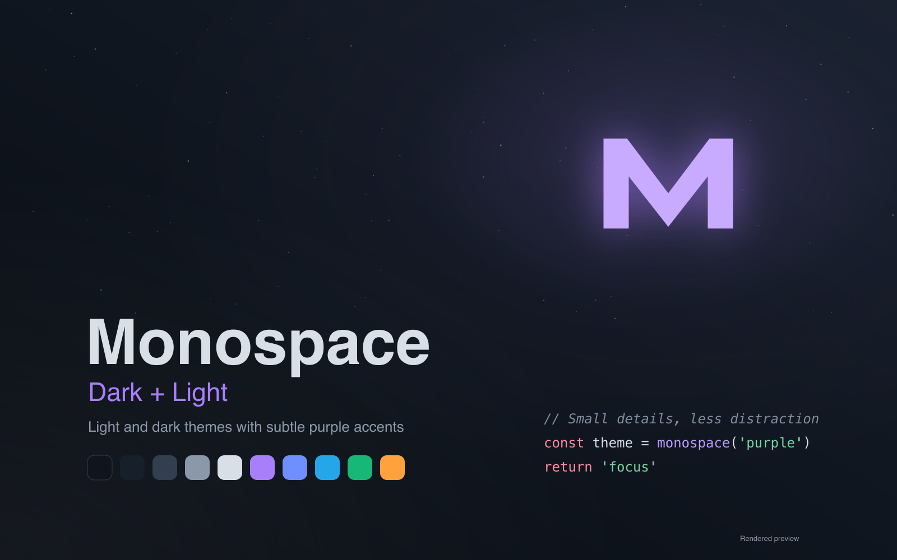
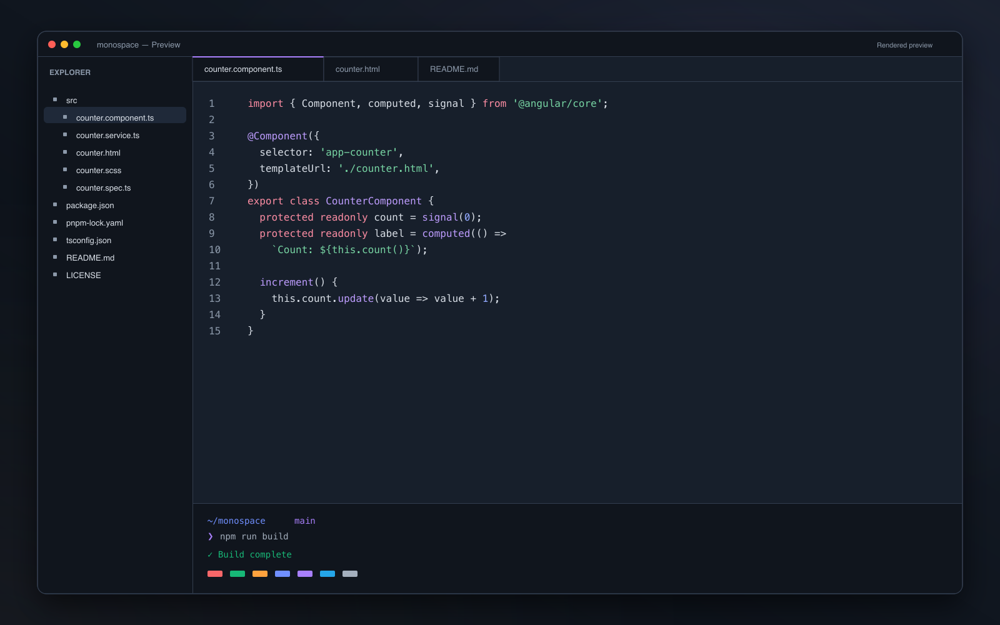
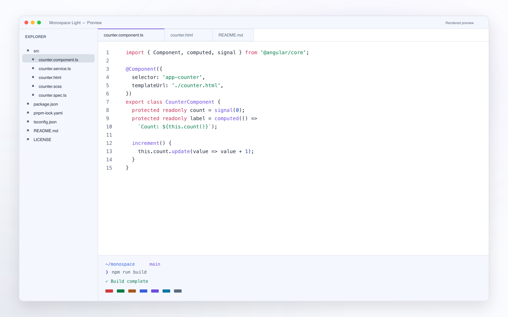

# Monospace Themes for Orca

Two appearances. One quiet palette.

[Monospace](https://github.com/keksiqc/monospace-theme) by **Keksi**, brought to [Orca](https://onorca.dev): blue-gray surfaces for Dark, crisp white surfaces for Light, subtle purple accents, and matching editor and terminal colors.

[](https://onorca.dev) [](#previews) [](LICENSE)



## Install

Requires **Orca 1.4.245 or newer**.

1. Open **Settings → Plugins**.
2. Choose **Add plugin → From a Git URL…** and enter:

   ```text
   https://github.com/faisalmuhammad/orca-monospace-themes#v1.1.2
   ```

   Keep `#v1.1.2` at the end. Orca requires a release tag or commit hash to install from Git.
3. In **Settings → Appearance**, choose **Monospace Dark** as the dark app theme and **Monospace Light** as the light app theme.
4. Choose the matching **Monospace Dark** or **Monospace Light** terminal palette, then select your preferred appearance.

Both variants are included in one plugin. Fonts, density, and layout remain controlled by Orca settings.

Want matching file icons? Install [Monospace Icons](https://github.com/faisalmuhammad/orca-monospace-icons) separately.

## Previews

| Monospace Dark | Monospace Light |
| --- | --- |
|  |  |

These images are **rendered previews** using the plugin's palette and syntax colors, rather than screenshots captured from Orca.

## Colors

| Surface | Dark | Light |
| --- | --- | --- |
| Editor background | `#171f2b` | `#ffffff` |
| Sidebar | `#10151d` | `#f4f7fd` |
| Main text | `#d9dfe7` | `#1f2939` |
| Purple accent | `#a87ffb` | `#6f4cde` |
| Keywords | `#fd8da3` | `#c43058` |
| Strings | `#77d5a3` | `#007b49` |
| Numbers and constants | `#92a9ff` | `#264dcb` |
| Comments | `#7f8d9f` | `#637083` |

Each appearance includes **48 syntax rules** and a matching **16-color ANSI terminal palette**. App text/surface pairs meet 4.5:1 contrast; retained syntax foregrounds meet 3:1 against the editor background.

Orca exposes fewer individual UI colors than VS Code, so some controls derive their colors from the app palette. Syntax rendering also depends on the language support available in Orca.

<details>
<summary>Port details and local development</summary>

The port preserves supported TextMate scopes, source rule order, foreground colors, and font styles. Descendant selectors containing spaces, unsupported background/content settings, semantic token colors, and low-contrast foregrounds are omitted. Translucent terminal selection colors are composited against the terminal background because Orca accepts RGB terminal colors.

To work on the plugin locally, clone this repository and add its root through **Settings → Plugins → Development folders…**. From a compatible Orca source checkout, validate it with:

```sh
pnpm validate:plugin path/to/orca-monospace-themes
```

</details>

## Attribution and license

An unofficial Orca port of [Monospace Theme](https://github.com/keksiqc/monospace-theme) by **Keksi** (`keksiqc`), maintained for Orca by [faisalmuhammad](https://github.com/faisalmuhammad). The original project describes its theme as a modified version of the theme used in Google IDX.

The port uses extension version **1.5.0**, pinned to upstream commit [`50761831abba262d3c259925fbddb1f6492ef891`](https://github.com/keksiqc/monospace-theme/tree/50761831abba262d3c259925fbddb1f6492ef891).

The upstream **MIT license**, including **Copyright © 2024 Keksi**, is preserved in [LICENSE](LICENSE). Additional upstream icon notices are retained in [LICENSE-GOOGLE](LICENSE-GOOGLE) (**Apache 2.0**) and [LICENSE-SETI](LICENSE-SETI) (**MIT; Copyright © 2014 Jesse Weed**). Those assets retain their respective licenses.

See [third-party notices](THIRD_PARTY_NOTICES.md) for the source and scope of these notices.
